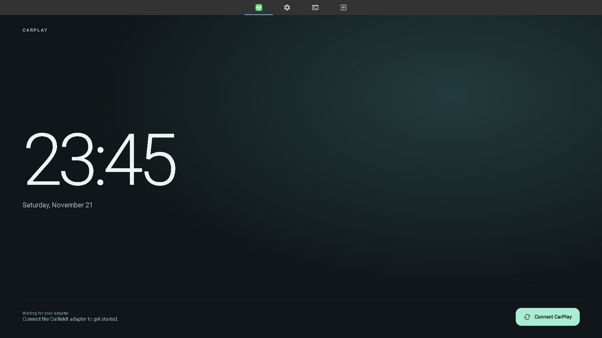
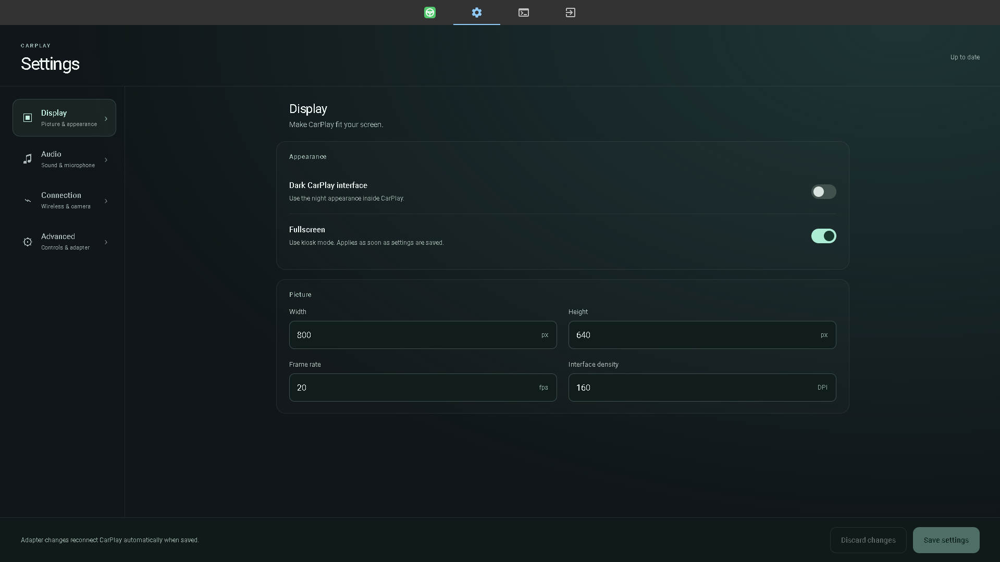
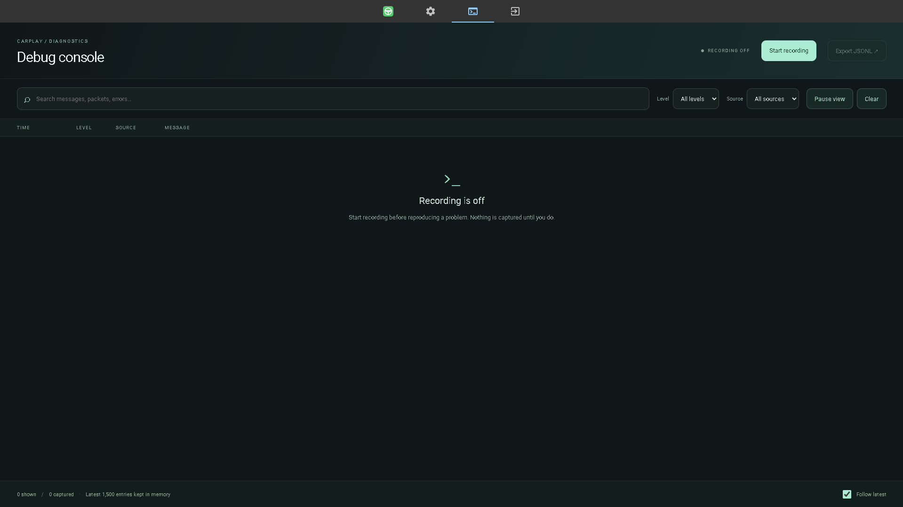

# React CarPlay

A CarPlay app for Raspberry Pi with a Carlinkit CPC200-CCPA adapter. Based on [Rhys Morgan's React CarPlay](https://github.com/rhysmorgan134/react-carplay), with a new interface, reconnect controls, and separate reverse and front camera support.

## CarPlay



The clock stays on screen until video arrives from the phone. If the phone disconnects, the reconnect button comes back. A connection attempt that gets stuck can be retried after 30 seconds.

## Settings



Settings are split into Display, Audio, Connection, and Advanced. Change the resolution, frame rate, microphone, Wi-Fi band, cameras, key bindings, and CAN triggers here.

Saving adapter settings restarts the CarPlay connection without closing the app. Reverse and front cameras have separate device selections. Reverse takes priority when both triggers are active.

## Debug console



Recording is **off by default**. Start it before reproducing a problem, stop it afterward, then export the logs as JSONL. Search and filter by level or source to find what you need.

The console keeps the latest 1,500 entries. Pause view stops the display from moving; it does not stop recording. Audio and video buffers are summarised instead of dumped into the log.

There is a place for navigation logs, but navigation packet decoding has not been added yet.

## Run it

You need Git and Node.js 22 or 24.

```sh
git clone https://github.com/iLightFPS/react-carplay.git
cd react-carplay
npm ci
npm run dev
```

To run the checks and build:

```sh
npm test
npm run build
```

Install dependencies on each machine. Do not copy `node_modules` from Windows to the Pi.

## Raspberry Pi and cameras

Connect the Carlinkit adapter over USB. For CAN camera triggers, you also need a working SocketCAN interface named `can0`, set up for your car's bus and bitrate. The app listens to CAN; it does not send vehicle CAN messages.

Choose your camera devices under **Settings → Connection**, then set the CAN ID, mask, and byte under **Advanced → Configure CAN signals**. Byte numbering starts at **0**. A mask of **0** leaves that trigger unused. Old `lights` mappings are kept as front-camera mappings.

Camera triggers clear after 1.5 seconds without fresh matching CAN frames. PiMost is currently disabled.

Once you have built an AppImage for your Pi:

```sh
bash setup-pi.sh /absolute/path/to/your.AppImage
```

This installs your AppImage, USB permissions, and autostart. It does not download the original project's release. You may need your distribution's FUSE package and a sign-out/sign-in after USB group permissions change.

## Windows

Windows can be used to work on the UI. CAN is loaded only on Linux.

The CPC200-CCPA has not been confirmed working on Windows with this fork. Installing WinUSB does not fix an adapter that still reports Code 10 or 43 in Device Manager.

## Testing

The app has passed a clean Windows install, TypeScript checks, the production build, and regression tests for reconnects, CAN signals, settings, and logging.

The latest changes still need testing on the Pi with a phone and cameras connected. That includes leaving and returning with the phone, microphone/audio, both camera triggers, and loss of CAN traffic. Existing dependency security advisories also need a separate update pass.

[Development notes](docs/development.md) cover logging hooks and the patched audio dependency.

## Credits

- [rhysmorgan134/react-carplay](https://github.com/rhysmorgan134/react-carplay)
- [rhysmorgan134/node-CarPlay](https://github.com/rhysmorgan134/node-CarPlay)
- The patched `pcm-ringbuf-player` source and its original MIT license are included under `vendor/pcm-ringbuf-player`.
